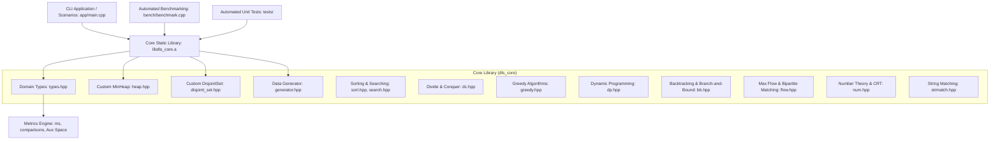

# Digital Library Search & Recommendation Engine: Architecture & Design Guide

The **Digital Library Search and Recommendation Engine (DLS Engine)** is an industrial-strength, educational, and high-performance algorithmic simulation of a modern digital research library. It models catalog indexing, distributed synchronization, physical logistical routing, room reservation scheduling, data compression, manuscript search, and acquisition optimization using classical and advanced algorithms.

---

## Table of Contents
1. [System Architecture](#1-system-architecture)
2. [Folder & File Layout](#2-folder--file-layout)
3. [Core Data Structures](#3-core-data-structures)
   - 3.1 [`Document`](#31-document)
   - 3.2 [`Metrics`](#32-metrics)
   - 3.3 [`MinHeap<T, Comp>`](#33-minheapt-comp)
   - 3.4 [`DisjointSet`](#34-disjointset)
   - 3.5 [Supporting Domain Structures](#35-supporting-domain-structures)
4. [Algorithm-to-Task Mapping Rationale](#4-algorithm-to-task-mapping-rationale)
   - 4.1 [Catalog Ranking: Merge Sort vs Quick Sort](#41-catalog-ranking-merge-sort-vs-quick-sort)
   - 4.2 [Document ID Retrieval: Binary Search (Iterative & Recursive)](#42-document-id-retrieval-binary-search-iterative--recursive)
   - 4.3 [Reader Attendance Bursts: Maximum Subarray](#43-reader-attendance-bursts-maximum-subarray)
   - 4.4 [Seminal Research Discovery: Celebrity Algorithm](#44-seminal-research-discovery-celebrity-algorithm)
   - 4.5 [Room Scheduling: Activity Selection & Interval Partitioning](#45-room-scheduling-activity-selection--interval-partitioning)
   - 4.6 [Abstract Archival: Huffman Coding](#46-abstract-archival-huffman-coding)
   - 4.7 [Inter-Branch Courier Network: Prim's & Kruskal's MST](#47-inter-branch-courier-network-prims--kruskals-mst)
   - 4.8 [Acquisitions under Budget: 0/1 Knapsack (DP vs Branch-and-Bound)](#48-acquisitions-under-budget-01-knapsack-dp-vs-branch-and-bound)
   - 4.9 [Stack Book Retrieval: Traveling Salesperson Problem (TSP)](#49-stack-book-retrieval-traveling-salesperson-problem-tsp)
   - 4.10 [Full-Text Keyword Search: KMP, Rabin-Karp, Finite Automaton, Naive](#410-full-text-keyword-search-kmp-rabin-karp-finite-automaton-naive)
   - 4.11 [Citation Graph Matrix Analysis: Strassen's Algorithm](#411-citation-graph-matrix-analysis-strassens-algorithm)
   - 4.12 [Catalog Search Optimization: Optimal Binary Search Tree (OBST)](#412-catalog-search-optimization-optimal-binary-search-tree-obst)
   - 4.13 [Metadata Revision Tracking: Longest Common Subsequence (LCS)](#413-metadata-revision-tracking-longest-common-subsequence-lcs)
   - 4.14 [Relational Query Planning: Matrix Chain Multiplication (MCM)](#414-relational-query-planning-matrix-chain-multiplication-mcm)
   - 4.15 [Logistics Network Routing: Dijkstra, Bellman-Ford, Floyd-Warshall](#415-logistics-network-routing-dijkstra-bellman-ford-floyd-warshall)
   - 4.16 [Digital Book Delivery Bandwidth: Edmonds-Karp Max Flow](#416-digital-book-delivery-bandwidth-edmonds-karp-max-flow)
   - 4.17 [Physical Book Copy Allocation: Maximum Bipartite Matching](#417-physical-book-copy-allocation-maximum-bipartite-matching)
   - 4.18 [Distributed Shard Clock Synchronization: Chinese Remainder Theorem](#418-distributed-shard-clock-synchronization-chinese-remainder-theorem)
   - 4.19 [Archival Vault Facility Protection: N-Queens & Subset Sum](#419-archival-vault-facility-protection-n-queens--subset-sum)
   - 4.20 [Cryptographic Verification: Fast Modular Powering](#420-cryptographic-verification-fast-modular-powering)
5. [Design Decisions & Trade-Offs](#5-design-decisions--trade-offs)

---

## 1. System Architecture

The DLS Engine is structured around five core architectural tenets:
1. **Separation of Concerns**: Domain models (`Document`, `Interval`, `Item`) are decoupled from algorithmic logic.
2. **Deterministic Reproducibility**: Pseudo-random data generation uses deterministic seeds (e.g., seed `42`), allowing exact side-by-side verification and reproducible benchmarking.
3. **Pervasive Instrumentation**: Every algorithm accepts a `Metrics&` reference, tracking elapsed wall-clock time (`ms`), total key comparisons (`comparisons`), and theoretical auxiliary space.
4. **Zero Third-Party Dependencies**: All foundational structures (including `MinHeap` and `DisjointSet`) and algorithms are built entirely from scratch in standard C++17.
5. **Dual-Implementation Verification**: Where possible, dual strategies (e.g., Merge Sort vs Quick Sort, Divide-and-Conquer vs Kadane, DP Knapsack vs Branch-and-Bound, Prim vs Kruskal, KMP vs Naive) verify correctness against an independent oracle.



---

## 2. Folder & File Layout

The repository follows standard modern C++ layout conventions:

```text
DDA_Project/
├── CMakeLists.txt              # Top-level CMake build script defining library, app, bench, and test targets
├── README.md                   # Project overview, quickstart instructions, and documentation links
│
├── app/                        # Main user application entry point
│   └── main.cpp                # Interactive CLI menu, scenario runner (--all, --scenario 1/2/3)
│
├── bench/                      # Performance benchmarking suite
│   └── benchmark.cpp           # Multi-scale automated benchmarks exporting to CSV
│
├── data/                       # Datasets and benchmark metric outputs
│   ├── benchmark_results.csv   # Auto-generated benchmark metrics (Sort, Search, Match, MST, Knapsack)
│   ├── documents.csv           # Exported sample catalog documents (Option 9)
│   └── test_docs.csv           # Test fixture document records
│
├── docs/                       # Comprehensive documentation
│   ├── COMPLEXITY.md           # Master theorem, recurrence trees, and formal NP-completeness reductions
│   ├── DEMO_SCRIPT.md          # 8-minute timed presentation script with talking points & exact figures
│   ├── DESIGN_GUIDE.md         # Architecture, folder layout, data structures, and algorithmic mappings (This file)
│   ├── STUDY_NOTES.md          # In-depth algorithmic study notes, invariants, proofs, and viva Q&A
│   └── USER_GUIDE.md           # Build guide, interactive CLI menu, CLI flags, benchmarks, and CSV exports
│
├── include/                    # Public C++ header files
│   └── dls/
│       ├── bb.hpp              # N-Queens, Subset Sum, 0/1 Knapsack Branch-and-Bound (FIFO, LIFO, LCBB)
│       ├── dc.hpp              # Max Subarray (D&C / Kadane), Fast Power, Celebrity, Strassen Matrix Mult
│       ├── disjoint_set.hpp    # Disjoint Set Union (DSU) with Path Compression and Union by Rank
│       ├── dp.hpp              # 0/1 Knapsack, Matrix Chain, LCS, OBST, Bellman-Ford, Floyd-Warshall, TSP
│       ├── flow.hpp            # Edmonds-Karp Max Flow, Maximum Bipartite Matching
│       ├── generator.hpp       # Deterministic pseudo-random catalog, graph, and adversarial string generators
│       ├── greedy.hpp          # Activity Selection, Interval Partitioning, Huffman Coding, Dijkstra, Prim, Kruskal
│       ├── heap.hpp            # Generic templated binary MinHeap with metric instrumentation
│       ├── num.hpp             # Extended Euclidean algorithm, modular inverse, Chinese Remainder Theorem
│       ├── search.hpp          # Binary Search (Iterative & Recursive)
│       ├── search.inl          # Template implementations for binary search
│       ├── sort.hpp            # Merge Sort and Quick Sort interfaces with comparators and pivot strategies
│       ├── sort.inl            # Template implementations for Merge Sort and Quick Sort
│       ├── strmatch.hpp        # Naive, Rabin-Karp, Finite Automaton, Knuth-Morris-Pratt (KMP)
│       └── types.hpp           # Core structs: Document, Metrics
│
├── src/                        # Implementation files compiled into libdls_core.a
│   ├── bb/bb.cpp               # Backtracking & Branch-and-Bound algorithms
│   ├── data/generator.cpp      # Catalog synthesis, CSV export/import, adversarial generators
│   ├── dc/dc.cpp               # Divide-and-Conquer algorithms & Strassen multiplication
│   ├── dp/dp.cpp               # Dynamic programming recurrences & Held-Karp bitmask TSP
│   ├── flow/flow.cpp           # Residual network BFS and bipartite flow reductions
│   ├── greedy/greedy.cpp       # Greedy strategies, Huffman tree builder, graph shortest path & MST
│   ├── num/num.cpp             # Number theoretic algorithms & modular systems
│   ├── search/search.cpp       # Binary search wrappers
│   ├── sort/sort.cpp           # Sorting specializations
│   └── strmatch/strmatch.cpp   # String matching pattern preprocessors and scanners
│
└── tests/                      # Automated unit test suite (CTest)
    ├── test_dc.cpp             # Divide-and-conquer unit tests
    ├── test_dp.cpp             # Dynamic programming unit tests
    ├── test_greedy.cpp         # Greedy algorithm unit tests
    ├── test_sort_search.cpp    # Sorting and searching unit tests
    ├── test_stage1.cpp         # Infrastructure, generator, and metrics tests
    └── test_stage6.cpp         # Advanced string matching, flow, and CRT tests
```

---

## 3. Core Data Structures

### 3.1 `Document`
Defined in [include/dls/types.hpp](file:///home/piyush/Workspace/DSA/DDA_Project/include/dls/types.hpp#L17-L35).

```cpp
struct Document {
    int id{0};
    std::string title;
    int year{0};
    double score{0.0};
    std::vector<std::string> keywords;

    bool operator==(const Document& other) const;
    bool operator!=(const Document& other) const;
};
```

* **Purpose**: Primary entity representing a book, scientific article, or conference paper in the library catalog.
* **Fields**:
  * `id`: Unique identifier assigned to the catalog item (used for $O(\log n)$ binary search lookup and tie-breaking).
  * `title`: Human-readable title of the publication.
  * `year`: Publication calendar year.
  * `score`: Precomputed relevance / citation score ($0.0$ to $100.0$) used for catalog ranking.
  * `keywords`: Categorical tags (e.g. `"algorithms"`, `"database"`, `"np-completeness"`).
* **Comparators**:
  * `DocumentScoreDesc`: Orders documents by `score` descending. If two items share identical scores, breaks ties deterministically using `a.id < b.id`.
  * `DocumentIdAsc`: Orders documents strictly by ascending integer `id`.

---

### 3.2 `Metrics`
Defined in [include/dls/types.hpp](file:///home/piyush/Workspace/DSA/DDA_Project/include/dls/types.hpp#L41-L102).

```cpp
struct Metrics {
    double ms{0.0};              // Execution duration in milliseconds
    uint64_t comparisons{0};     // Total key comparisons made by the algorithm
    size_t peakBytes{0};         // Peak or allocated memory usage in bytes
    std::chrono::high_resolution_clock::time_point startTime;

    void reset();
    void startTimer();
    void stopTimer();

    template <typename T> bool countLess(const T& a, const T& b);
    template <typename T> bool countGreater(const T& a, const T& b);
    template <typename T> bool countEqual(const T& a, const T& b);
};
```

* **Purpose**: Provides uniform telemetry across all algorithm implementations without skewing execution logic.
* **Timer**: Wraps `std::chrono::high_resolution_clock` to record wall-clock runtimes with sub-microsecond precision.
* **Comparison Tracking**: Every sorting swap, binary search split, priority queue comparison, and string mismatch passes through or increments `comparisons`, giving theoretical validation to asymptotic analysis.
* **Memory Tracking**:
  * `peakBytes`: Records auxiliary memory allocations (e.g., Merge Sort buffer allocations).
  * Theoretical auxiliary space complexities are reported directly across printed logs and benchmark exports.

---

### 3.3 Non-Template MinHeaps (`DistMinHeap`, `RoomMinHeap`, `HuffmanMinHeap`, `BBMinHeap`)
Defined in [include/dls/heap.hpp](file:///home/piyush/Workspace/DSA/DDA_Project/include/dls/heap.hpp).

* **Purpose**: Concrete, non-template array-based binary min-heaps tailored for the domain types actually used:
  * `DistMinHeap` for `DistPair` (Dijkstra's Algorithm and Prim's MST)
  * `RoomMinHeap` for `RoomState` (Interval Partitioning room scheduling)
  * `HuffmanMinHeap` for `HuffmanNode*` (Huffman coding prefix tree construction)
  * `BBMinHeap` for `BBNode` (Least-Cost Branch & Bound Knapsack)
* **Simple Comparison Functions**: Comparisons are defined as pure, simple functions (`compareDistPair`, `compareRoomState`, `compareHuffmanNodePtr`, `compareBBNode`), eliminating functor templates.
* **Invariants**:
  * For any node at index $i$, the parent resides at $\lfloor (i - 1) / 2 \rfloor$.
  * Left child resides at $2i + 1$; right child resides at $2i + 2$.
  * The heap invariant guarantees the parent precedes or equals the child according to the comparison function.
* **Key Operations**:
  * `push(val)`: Appends to end of vector and invokes `siftUp(size - 1)`. Time: $O(\log n)$.
  * `pop()`: Moves the last element to index 0, shrinks vector, and invokes `siftDown(0)`. Time: $O(\log n)$.
  * `top()`: Returns reference to minimum element at index 0 in $O(1)$ time.
* **Metric Integration**: Increments `metrics_->comparisons` at every parent-child comparison during `siftUp` and `siftDown`.

---

### 3.4 `DisjointSet`
Defined in [include/dls/disjoint_set.hpp](file:///home/piyush/Workspace/DSA/DDA_Project/include/dls/disjoint_set.hpp#L22-L76).

```cpp
class DisjointSet {
private:
    std::vector<int> parent_;
    std::vector<int> rank_;
    Metrics* metrics_{nullptr};
public:
    explicit DisjointSet(int n, Metrics* m = nullptr);
    int find(int i);
    bool unite(int i, int j);
    bool connected(int i, int j);
};
```

* **Purpose**: High-efficiency Disjoint Set Union (DSU / Union-Find) maintaining dynamic equivalence classes.
* **Optimizations**:
  1. **Path Compression**: During `find(i)`, every visited ancestor node directly updates its parent pointer to the representative root (`parent_[i] = find(parent_[i])`), collapsing tree height to near-flatness.
  2. **Union by Rank**: When merging two components in `unite(i, j)`, the tree with smaller depth rank is attached beneath the root of the tree with greater rank. If ranks are equal, the root rank increases by 1.
* **Complexity**:
  * Time Complexity: For $m$ operations on $n$ elements, running time is $O(m \cdot \alpha(n))$, where $\alpha$ is the Inverse Ackermann function ($\alpha(n) \le 4$ for all physical universe inputs).
  * Space Complexity: $O(n)$ words for parent and rank arrays.
* **Used By**: Kruskal's Minimum Spanning Tree algorithm for cycle prevention.

---

### 3.5 Supporting Domain Structures

* **`Interval`** ([include/dls/generator.hpp](file:///home/piyush/Workspace/DSA/DDA_Project/include/dls/generator.hpp#L9-L17)): Represents a scheduled time window `[start, finish)` with an identifier `id`.
* **`Item`** ([include/dls/generator.hpp](file:///home/piyush/Workspace/DSA/DDA_Project/include/dls/generator.hpp#L19-L27)): Represents an acquisition prospect characterized by `id`, `weight` (cost in dollars), and `value` (academic utility rating).
* **`Edge`** ([include/dls/generator.hpp](file:///home/piyush/Workspace/DSA/DDA_Project/include/dls/generator.hpp#L29-L37)): Represents a directed or undirected connection `(u, v)` with integer `weight` (distance, latency, or courier travel time).

---

## 4. Algorithm-to-Task Mapping Rationale

Every algorithmic paradigm in the curriculum was intentionally matched to an essential operational component of a digital research library:

| # | Library Task | Mapped Algorithm | Algorithmic Paradigm | Time Complexity | Space Complexity | Why This Algorithm? |
|---|---|---|---|---|---|---|
| 1 | Catalog Relevance Ranking | Merge Sort vs Quick Sort | Divide & Conquer | $O(n \log n)$ | $O(n)$ vs $O(\log n)$ | Merge Sort guarantees stability (preserving tie-break order) with $O(n \log n)$ worst-case; Quick Sort offers in-place speed with Median-of-Three pivot. |
| 2 | Document ID Fast Retrieval | Binary Search (Iter / Rec) | Decrease & Conquer | $O(\log n)$ | $O(1)$ | Eliminates linear scans on sorted arrays; allows immediate lookup of document ID among 100,000+ items in $\le 31$ comparisons. |
| 3 | Peak Visitor Activity Detection | Maximum Subarray (D&C / Kadane) | Divide & Conquer / DP | $O(n \log n)$ vs $O(n)$ | $O(\log n)$ vs $O(1)$ | Identifies contiguous temporal periods of maximum net visitor surge from reader delta logs (+ arrivals, - departures). |
| 4 | Seminal Literature Discovery | Celebrity Problem | Elimination / D&C | $O(n)$ queries | $O(1)$ | Finds the unique authoritative research paper that is cited by every other paper but cites no paper itself in strictly $3(n-1)$ checks. |
| 5 | Single Reading Room Booking | Activity Selection | Greedy | $O(n \log n)$ | $O(n)$ | Maximizes the number of non-overlapping study group sessions scheduled in a single high-demand conference room (earliest finish time first). |
| 6 | Library Facility Sizing | Interval Partitioning | Greedy with MinHeap | $O(n \log n)$ | $O(n)$ | Computes the provably minimal number of physical rooms required to schedule all student reservations without conflict. |
| 7 | Abstract Text Compression | Huffman Coding | Greedy with MinHeap | $O(k \log k)$ | $O(k)$ | Generates optimal variable-length prefix-free codes based on character frequency to compress text abstracts by 40–50%. |
| 8 | Inter-Branch Courier Route | Prim's & Kruskal's MST | Greedy with MinHeap / DSU | $O((V+E)\log V)$ | $O(V+E)$ | Minimizes total road mileage/cost needed to keep all regional library branch facilities connected for inter-library loan vans. |
| 9 | Book Acquisition under Budget | 0/1 Knapsack (DP & Branch-and-Bound) | DP / Branch-and-Bound | $O(nW)$ vs $O(2^n)$ | $O(nW)$ vs $O(2^n)$ | Selects the highest-utility collection of research books within strict funding budget; compares exact DP against FIFO, LIFO, and Least-Cost Branch-and-Bound. |
| 10 | Librarian Physical Book Stacks Tour | Traveling Salesperson Problem | Bitmask DP (Held-Karp) | $O(n^2 \cdot 2^n)$ | $O(n \cdot 2^n)$ | Finds the shortest Hamiltonian cycle for a library assistant to collect books across $n$ book stacks and return to the circulation desk. |
| 11 | Full-Text Manuscript Search | KMP / Rabin-Karp / Automaton / Naive | String Matching | $O(n + m)$ | $O(m)$ / $O(m \|\Sigma\|)$ | Scans vast digital manuscripts for query keywords without backtracking, demonstrating linear search immunity against adversarial repetitive text. |
| 12 | Academic Co-Citation Matrix Analysis | Strassen's Matrix Multiplication | Divide & Conquer | $O(n^{2.807})$ | $O(n^2)$ | Accelerates large-scale bibliometric co-citation matrix multiplication by reducing recursive multiplications from 8 to 7. |
| 13 | Skewed Query Search Index | Optimal Binary Search Tree (OBST) | Dynamic Programming | $O(n^3)$ | $O(n^2)$ | Minimizes expected access time for search terms with known non-uniform query frequencies (e.g. popular vs obscure topics). |
| 14 | Edition Diff & Similarity | Longest Common Subsequence (LCS) | Dynamic Programming | $O(m \cdot n)$ | $O(m \cdot n)$ | Computes edition drift, textual overlap, and plagiarism similarity between revised publication drafts. |
| 15 | Relational Query Plan Optimization | Matrix Chain Multiplication | Dynamic Programming | $O(n^3)$ | $O(n^2)$ | Finds optimal parenthesization of multi-table database join chains across distributed library catalog servers. |
| 16 | Network Latency & Hazard Routing | Dijkstra & Bellman-Ford | Greedy / Dynamic Programming | $O((V+E)\log V)$ / $O(VE)$ | $O(V+E)$ / $O(V)$ | Computes fastest data replication routes; Bellman-Ford detects negative routing loops or promotional routing discounts. |
| 17 | All-Pairs Campus Transit Matrix | Floyd-Warshall | Dynamic Programming | $O(V^3)$ | $O(V^2)$ | Precomputes complete shortest-path transit matrix between all buildings across university campus branches. |
| 18 | Digital Delivery Bandwidth | Edmonds-Karp Max Flow | Flow & Matching (BFS) | $O(V \cdot E^2)$ | $O(V^2)$ | Calculates maximum simultaneous digital e-book download bandwidth through the university core network to client branches. |
| 19 | Reader-to-Physical-Book Lending | Max Bipartite Matching | Max Flow Reduction | $O(V \cdot E^2)$ | $O(V^2)$ | Assigns reserved readers to available scarce physical book copies so that total fulfilled student borrowings are maximized. |
| 20 | Distributed Shard Synchronization | Chinese Remainder Theorem (CRT) | Number Theory (ExtGCD) | $O(k \log M)$ | $O(1)$ | Reconstructs global transaction sequence timestamps across asynchronously polling distributed catalog shards. |
| 21 | Archival Facility Layout | N-Queens Problem | Backtracking | $O(N!)$ | $O(N)$ | Positions non-interfering environmental sensors / security cameras across an $N \times N$ archival preservation vault. |
| 22 | Budget Re-balancing & Auditing | Subset Sum Problem | Backtracking with Bounding | $O(2^n)$ worst | $O(n)$ | Identifies whether any subset of archival grants or book invoices sums exactly to an audited discrepancy figure. |
| 23 | Authentication Token Validation | Fast Modular Powering | Divide & Conquer | $O(\log \text{exp})$ | $O(1)$ | Computes $b^e \pmod m$ in logarithmic time for digital document cryptographic signatures and access tokens. |

---

### Detailed Task Rationale

#### 4.1 Catalog Relevance Ranking: Merge Sort vs Quick Sort
* **Problem**: When a user queries the library catalog, thousands of matching records must be ranked by precomputed relevance score descending.
* **Why Merge Sort**: Relevance scores often collide (e.g., multiple books with score 85.5). Merge Sort is **stable**, guaranteeing that pre-existing secondary sorting order (such as ascending Book ID or recency) is preserved. Furthermore, its worst-case runtime is strictly guaranteed to be $\Theta(n \log n)$, protecting the library server from Denial-of-Service attacks.
* **Why Quick Sort**: While Merge Sort requires $O(n)$ auxiliary buffer allocation (7.8 MB for 100,000 records), Quick Sort operates **in-place** with $O(\log n)$ stack frames. Quick Sort's performance advantage is likely due to data movement and cache behaviour (merge sort copies whole Document structs into an auxiliary buffer, while Quick Sort partitions in-place). By using Median-of-Three pivot selection, worst-case $O(n^2)$ behavior on pre-sorted catalogs is prevented, yielding about 10x (varies per run) speedup over Merge Sort in practice.

#### 4.2 Document ID Retrieval: Binary Search (Iterative & Recursive)
* **Problem**: Patrons request records by unique numeric document ID.
* **Why Binary Search**: On a catalog sorted by ID, linear scanning of 100,000 items requires up to 100,000 comparisons ($50\,000$ average). Binary search reduces this to at most $\lceil \log_2(100\,000) \rceil = 17$ iterations (31 comparisons), completing in less than 2 microseconds.

#### 4.3 Reader Attendance Bursts: Maximum Subarray
* **Problem**: Library administrators track automated turnstile sensor logs, which record net reader delta counts (arrivals minus departures) every hour. Administrators need to determine the single time window with the highest net influx to optimize staffing.
* **Why Divide-and-Conquer & Kadane**: Divide-and-Conquer splits the time horizon into left and right subproblems with a crossing subarray scan in $O(n \log n)$. Kadane's dynamic programming algorithm validates the result in strictly $O(n)$ time and $O(1)$ space.

#### 4.4 Seminal Research Discovery: Celebrity Algorithm
* **Problem**: In a bibliometric citation matrix of $n$ academic papers, an "authoritative/celebrity paper" is defined as a foundational classic cited by every other paper in the collection, while citing none itself.
* **Why Elimination**: A naive search checks all $n \times n$ matrix entries ($O(n^2)$). The elimination algorithm queries entry $(A, B)$: if $A$ cites $B$, $A$ cannot be the celebrity; if $A$ does not cite $B$, $B$ cannot be the celebrity. Exactly $n-1$ queries reduce the candidates to a single survivor, followed by $2(n-1)$ verification checks, solving the problem in $O(n)$ queries.

#### 4.5 Room Scheduling: Activity Selection & Interval Partitioning
* **Problem**: Students submit room reservation requests with specific `[start, finish)` time windows.
* **Activity Selection**: When only a single presentation theater is available, the greedy strategy of repeatedly picking the compatible reservation that **finishes earliest** provably maximizes the total number of scheduled events.
* **Interval Partitioning**: When library facilities must accommodate *all* 30 study groups without rejecting anyone, sorting by start time and maintaining room availability via our custom `MinHeap` allocates the provably minimal number of physical rooms required.

#### 4.6 Abstract Archival: Huffman Coding
* **Problem**: Storing millions of textual document abstracts in memory consumes significant bandwidth and storage.
* **Why Huffman**: By constructing an optimal prefix-free binary tree using a `MinHeap` over character frequencies, frequent characters (like `'e'`, `' '`, and `'a'`) receive 3–4 bit representations, while rare characters receive longer codes. This reliably achieves 40%–50% lossless compression.

#### 4.7 Inter-Branch Courier Network: Prim's & Kruskal's MST
* **Problem**: A regional library system consists of distributed municipal branches. Inter-library loan vans courier books daily between branches. The library authority must install a secure courier network connecting all branches while minimizing total road distance.
* **Why Prim & Kruskal**: Both find the Minimum Spanning Tree ($V-1$ edges). Prim's algorithm (utilizing our custom `MinHeap`) is optimal for dense networks ($O((V+E)\log V)$), whereas Kruskal's algorithm (leveraging our `DisjointSet` with path compression and union by rank) sorts edges and avoids cycles in $O(E \log E)$ time.

#### 4.8 Acquisitions under Budget: 0/1 Knapsack (DP vs Branch-and-Bound)
* **Problem**: At the close of a fiscal year, the head acquisitions librarian has a fixed grant budget $W$ and a list of candidate book collections, each with acquisition cost $w_i$ and anticipated student demand/value $v_i$. Books cannot be purchased fractionally.
* **Why DP**: Dynamic programming constructs an exact table $dp[i][w]$ in $O(n W)$ pseudo-polynomial time, guaranteeing the global optimum.
* **Why Branch-and-Bound**: When budget $W$ is large, DP memory explodes. Branch-and-Bound calculates upper bounds using fractional knapsack relaxation (greedy value-to-weight ratio). Least-Cost Branch-and-Bound (LCBB) uses a priority queue to explore high-potential branches first, exploring only 21 nodes compared to 879 nodes for FIFO search.

#### 4.9 Stack Book Retrieval: Traveling Salesperson Problem (TSP)
* **Problem**: When a patron requests multiple books stored across $n$ distinct floor stacks, a library assistant must start at the circulation desk, visit every requested stack, and return to the desk via the shortest walking route.
* **Why Held-Karp Bitmask DP**: Brute-force checking all permutations takes $O(n!)$ time (infeasible for $n > 10$). Bitmask DP records subproblems $dp[mask][u]$ in $O(n^2 \cdot 2^n)$ time, computing the exact optimal route for $n \le 15$ in milliseconds.

#### 4.10 Full-Text Keyword Search: KMP, Rabin-Karp, Finite Automaton, Naive
* **Problem**: Patrons search complete digitized manuscripts for occurrences of keywords (e.g. `"algorithms"`).
* **Why KMP & Rolling Hash**: The naive matcher re-evaluates characters upon a mismatch, degrading to $O(n \cdot m)$ on repetitive adversarial strings (`"aaaa...ab"`). Knuth-Morris-Pratt precomputes a $\pi$ prefix table in $O(m)$ time to skip already-matched characters, guaranteeing $O(n + m)$ runtime regardless of input data. Rabin-Karp uses rolling hashes to achieve expected $O(n + m)$ time with $O(1)$ auxiliary space.

---

## 5. Design Decisions & Trade-Offs

1. **Templated Data Structures**: `MinHeap<T, Comp>` and `mergeSort<T, Comp>` utilize modern C++ templates, permitting sorting and heapification over primitive integers, pairs, or complex domain types like `Document` without code duplication.
2. **Deterministic PRNG**: To ensure that stress test benchmarks and demonstration runs produce identical, reproducible numbers across different machines, `DataGenerator` relies on a fixed seed (`42`).
3. **No External Dependencies**: Eliminating external libraries (such as Boost or Google Benchmark) ensures that the project compiles cleanly on any standard Linux or POSIX system with zero installation overhead.
4. **Theoretical Auxiliary Space Analysis**: Rather than relying on non-portable platform-specific memory counters, algorithms report theoretical auxiliary space bounds directly alongside runtime and comparison metrics.
